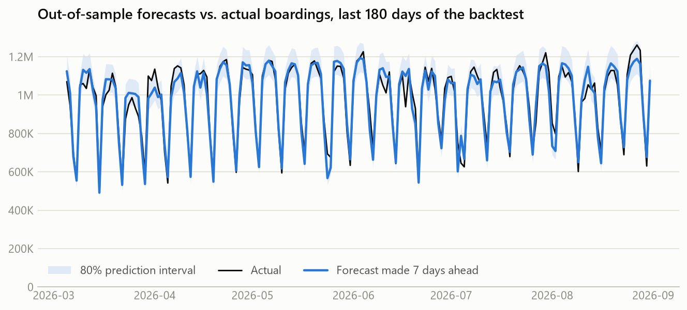
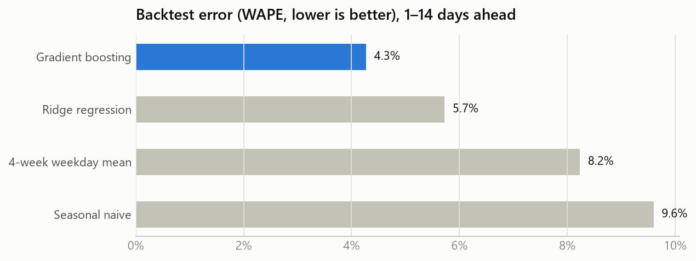
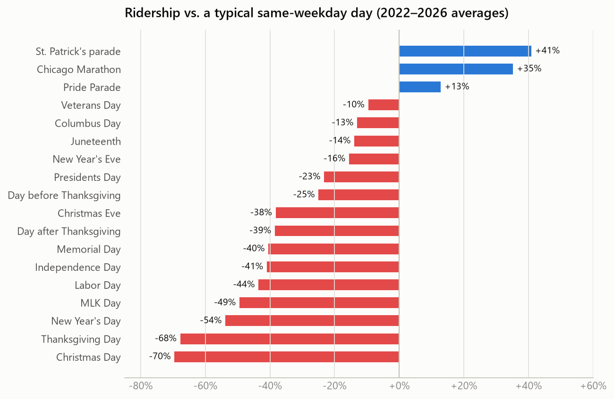

# Chicago Transit Ridership Forecasting

Daily ridership forecasts two weeks ahead for the Chicago Transit Authority (CTA), built from 25 years of boarding counts, daily weather, holidays and city events.

**[Live dashboard](https://mehtaaarush.github.io/transit-ridership-forecasting/)** · [Analysis notebook](notebooks/ridership_analysis.ipynb) · Python · pandas · scikit-learn · Plotly · GitHub Pages



## Highlights

- **4.3% forecast error (WAPE)** on 5,005 out-of-sample forecasts covering a full year (Sep 2025 – Aug 2026). That is **56% less error than a seasonal-naive forecast** and **48% less than the 4-week weekday average** planners typically use.
- **Calibrated uncertainty**: 80% prediction intervals from split-conformal residual quantiles achieved **77% realised coverage**.
- **Leak-free validation**: a rolling-origin backtest with monthly refits. Origin features use only data published by the forecast date, and a unit test tampers with future values to prove it.
- **Two-source data pipeline**: the City of Chicago Socrata API (ridership) joined to the Open-Meteo archive API (weather), with automated quality checks.
- **Model in the browser**: the 400-tree gradient-boosting model is exported to JSON and re-run in JavaScript for a what-if planner. A test holds the JS output to the scikit-learn predictions within 1e-9.

## The problem

Transit agencies set staffing, service frequency and crowding plans from daily demand forecasts. Since 2020 that has become harder.
Ridership collapsed by more than 80%, has grown every year since, and the weekday/weekend mix has changed. Any model has to handle a moving level and big calendar effects on top of it.

## Results

| Model | WAPE | MAPE | MAE (riders/day) | Bias | 80% interval coverage |
|---|---:|---:|---:|---:|---:|
| **Gradient boosting** | **4.3%** | **4.7%** | **40,167** | −0.1% | 77% |
| Ridge regression | 5.7% | 6.3% | 53,844 | +0.3% | 80% |
| 4-week weekday mean (planner's rule of thumb) | 8.2% | 10.2% | 77,432 | −0.1% | 77% |
| Seasonal naive (same weekday, last week) | 9.6% | 11.8% | 90,288 | −0.1% | 77% |



Gradient boosting holds roughly the same error from 1 to 14 days ahead (4.2–4.3% WAPE at every horizon). Once the ridership level is fixed at the
forecast origin, the target day's calendar and weather explain most of the variation. The baselines lose accuracy past 7 days, when their anchor week gets older.

## Key findings

1. **Weekends are back, weekdays are not.** Over the last 12 months Sundays ran at 93% and Saturdays at 89% of 2019 ridership, but weekdays only at 71%.
   Hybrid work changed the commute far more than leisure travel. Overall ridership is 75% of 2019 and still growing (+4.2% year over year).
2. **Buses carry more of the load.** Buses delivered 59% of rides in the last 12 months, against 52% before the pandemic. Rail, more tied to downtown offices, has recovered more slowly.
3. **Holidays and events dwarf the weather.** Christmas and Thanksgiving remove about 70% of riders, and MLK Day about half. The St. Patrick's parade adds 41% and the Marathon 35%.
4. **Extreme cold is the weather effect that matters.** Days with a mean temperature below 10°F lose about 18% of riders. Heavy rain (0.5 in+) costs about 6%.
5. **The remaining large misses are rare shocks.** Extreme-cold days with short-notice closures and the July 4th 2026 weekend account for the largest errors. An events and closures feed is the most valuable next data source.



## Approach

**Data.** `ridership/data.py` downloads the full CTA *Daily Boarding Totals* table and daily Loop weather. It enforces a continuous daily index and
checks that bus + rail reconciles to the total. A snapshot of both sources is committed in `data/raw/` so the pipeline is reproducible offline.

**Framing.** Direct multi-horizon forecasting. Each training row pairs a forecast origin *T* with a target day *T + h* (h = 1…14). The target is
`log(riders[T+h] / level[T])`, where `level` is the mean of the 28 days ending at *T* (exactly four of each weekday). Modelling the ratio keeps the model
valid while the post-pandemic level keeps rising.

**Features** (`ridership/features.py`, `ridership/calendar_features.py`)
- Calendar: weekday, day of year, horizon.
- Holidays: observed federal holidays split by CTA service schedule (validated against the agency's own `day_type` column), holiday eves, Thanksgiving weekend, and fixed-date holidays that fall on a weekend.
- Recurring events, generated from their scheduling rules: Chicago Marathon (2nd Sunday of October), St. Patrick's parade (Saturday before March 17), Pride Parade (last Sunday of June).
- Weather: mean temperature, feels-like minimum, precipitation, snowfall, and the previous day's snowfall.
- Origin state: the recent same-weekday profile (median of the last four same weekdays ÷ level) and four-week momentum.

**Models** (`ridership/models.py`): seasonal naive, 4-week weekday mean, ridge regression with calendar dummies and weather terms, and gradient-boosted trees
(scikit-learn, 400 trees, depth 4, subsample 0.8). Training data starts in July 2022.

**Validation** (`ridership/backtest.py`): a rolling-origin backtest over the final 12 months. At the start of each month every model is refit on targets
observed before that month, then forecasts every origin in the month at all 14 horizons. WAPE (total absolute error ÷ total riders) is the headline
metric because it weights errors by the riders affected.

**Prediction intervals**: before each refit, an inner model trained without the most recent year forecasts that year. The 10th and 90th percentiles
of its log residuals per horizon set the 80% interval (split-conformal style). The realised coverage is reported, not assumed.

**Dashboard** (`docs/`): a static site on GitHub Pages with Plotly charts, a backtest explorer and a what-if planner. The exported trees are evaluated by `docs/assets/gbm.js`.

## Project structure

```
transit-ridership-forecasting/
├── ridership/               # Python package: the whole pipeline
│   ├── data.py              # API downloads, cleaning, validation
│   ├── calendar_features.py # holidays (CTA-schedule aware) and recurring events
│   ├── features.py          # direct multi-horizon training frame
│   ├── models.py            # baselines, ridge, gradient boosting, intervals
│   ├── backtest.py          # rolling-origin evaluation with monthly refits
│   ├── analysis.py          # descriptive analysis (recovery, holiday and weather effects)
│   ├── forecast.py          # production fit + 14-day forecast
│   ├── export.py            # dashboard JSON + tree export for the browser
│   ├── figures.py           # README figures
│   └── pipeline.py          # python -m ridership.pipeline
├── tests/                   # pytest: leakage, calendar, models, JS/Python parity
├── notebooks/               # executed analysis walkthrough
├── data/raw/                # committed snapshot of both sources
├── reports/                 # backtest metrics + figures
└── docs/                    # GitHub Pages dashboard
```

## Run it yourself

```bash
python -m venv .venv
.venv\Scripts\activate          # macOS/Linux: source .venv/bin/activate
pip install -r requirements.txt

python -m ridership.pipeline            # backtest, final model, dashboard data, figures (~3 min)
python -m ridership.pipeline --refresh  # same, after re-downloading the latest data
pytest                                  # 14 tests
python -m http.server -d docs 8000      # dashboard at http://localhost:8000
```

## Limitations and next steps

- **Observed weather in the backtest.** A production system would feed weather *forecasts*, which adds error at longer horizons.
- **Unscheduled events** (protests, closures on extreme-cold days) are invisible to the model. A closures and events feed is the obvious addition.
- **Tree models do not extrapolate.** The planner barely reacts to combinations never seen in training (for example, snow at 70°F), and the dashboard flags this.
- **System-wide totals only.** Route- or station-level forecasts (also published by the City of Chicago) would support service planning more directly.

## Data and license

- Ridership: [CTA – Ridership – Daily Boarding Totals](https://data.cityofchicago.org/Transportation/CTA-Ridership-Daily-Boarding-Totals/6iiy-9s97), City of Chicago Data Portal.
- Weather: [Open-Meteo](https://open-meteo.com/) historical weather API, licensed CC BY 4.0.
- Code: MIT License © 2026 Aarush Mehta.
